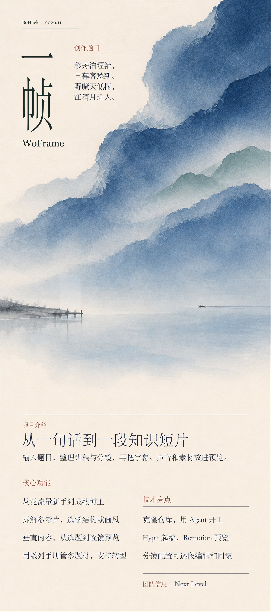

<p align="center">
  
</p>

<p align="center">
  <b>从一句话，到一段知识短片。</b><br>
  面向知识短视频创作者的 Agent 工作流，覆盖选题、写稿、配音和成片
</p>

<p align="center">
  
  
  
  
  <a href="LICENSE"></a>
</p>

---

[三条创作路线](#三条创作路线) · [成片样例](#demo-展示) · [快速开始](#快速开始)

## WoFrame 解决什么问题

做系列视频有两笔成本。整段调用视频生成模型时，费用会随生成时长和重做次数增加。连更时，已经确定的画面版式、字幕、封面和声线，也常常需要逐集重新设置。

**WoFrame（一帧）** 是面向知识短视频创作者的 Agent 工作流。你可以带着选题、已有文稿或录好的口播开始，和 Agent 逐步确认路线、脚本、素材和配音，再预览成片。路线Ⅱ和Ⅲ用插图、图解、声轨和实拍素材在本地合成视频。改文稿、字幕或插图后，可以重用已有素材和分镜设置重新渲染。

## 三条创作路线

| 路线 | 适合谁 | 怎么做 |
| --- | --- | --- |
| Ⅰ 泛流量 | 想快速验证新选题或讲法 | 确认参考片，拆解开场、段落节奏和画面风格，由 Hypit 用新文稿和素材组装初版。 |
| Ⅱ 不露脸垂直 | 想围绕一个主题持续更新 | 定稿后选本地 AI 配音或使用本集自录旁白，按实际声轨安排插图、图解和字幕，再用 Remotion 出片。 |
| Ⅲ 露脸个人 IP | 想亲自出镜讲解 | 从原片选取保留的段落。用 Remotion 保留原声，在真人全屏、口播小窗和辅助图解之间切换。 |

- **Hypit** 帮助 Agent 分析参考片并组装可编辑的视频，适合把已选定的讲法用到新题目上。路线Ⅰ按需调用外部工具和在线服务。[Hypit 项目](https://github.com/hypit-ai/hypit) · [环境配置](docs/environment.md#泛流量工具配置)
- **Remotion** 用 React 组件组织画面、字幕和动效。WoFrame 把分镜、声轨、素材路径和发布规格写进 `episode.json`，用同一套渲染逻辑预览和导出。创作者确认关键取舍，Agent 串起脚本、素材组织、校验和出片。[Remotion 项目](https://github.com/remotion-dev/remotion) · [创作流程](docs/creator-workflows.md)

## 系列如何复用和更新

1. **首集确认后保存。** 路线Ⅱ和Ⅲ把确认过的主画幅、视觉风格、封面、声线或小窗设置写入系列 Handbook。
2. **续集先读取设置。** Agent 按赛道和系列找到 Handbook，再就新主题、文稿和素材提问。可以用同一套栏目做法持续生产多集。单集配置也能批量导出所需画幅，多个发布入口使用同一画幅时共用一个 MP4。
3. **审片后按需更新。** 同一系列只更新这次确认的字段。例如新一集换了声线，已确认的封面样式仍可沿用。创作方向改变时，重新选路线，旧 Handbook 留给原来的系列。[查看 Handbook 的保存和复用方法](handbooks/README.md)

### 本地项目和成品怎么存

| 位置 | 保存内容 |
| --- | --- |
| `public/work/<项目>/` | 单集 `episode.json` 与图片、录音、视频素材。使用相对路径，保留整个目录即可继续审片、修改和渲染。 |
| `handbooks/<赛道>/<系列名>.json` | 经过确认的系列设置，供同赛道的续集加载。 |
| `output/<赛道>/<系列名>/` | 成片与封面。Remotion 成片按集号、标题和画幅命名，例如 `EP01-标题-9x16.mp4`。 |

本地项目、系列配置和成品目录默认由 Git 忽略，便于将创作素材与公开代码分开管理。

## 创作选项

以下选项适用于使用 Remotion 的路线Ⅱ和Ⅲ。

| 你可以选择 | WoFrame 支持 |
| --- | --- |
| 旁白与语言 | 路线Ⅱ的本地 Qwen3-TTS 支持中文、英文、日文、韩文，可用同一段稿件试听不同声线。也可使用自己录好的本集旁白。模型准备好后可离线合成。 [配音说明](docs/environment.md#合成旁白) |
| 插图、实拍与配乐 | 逐镜指定自己选的照片或插图，也可加入背景音乐。插图支持 PNG、JPEG、WebP。配合实际声轨安排换图与图解出现的时机。 [默认动效](docs/remotion-motion.md) |
| 片内版式 | 可用纸页拼贴、步骤卡片、比较和数字图解，也可指定字幕高亮词句与转场。真人口播可选圆角或圆形小窗，逐镜调整取景。 [纸页拼贴](docs/paper-collage.md) · [口播模板](docs/persona-video-template.md) |
| 画幅、画质与封面 | Remotion 支持 9:16、16:9、3:4、4:3、1:1，以及 480p、720p、1080p。可按发布入口预览和导出。封面提供五套可重排的模板。 [发布规格](docs/publishing-formats.md) · [封面风格](docs/cover-styles.md) |

## Demo 展示

下面是两条 Remotion 路线已经制作的样例。

### Ⅱ 不露脸垂直 · 读书短片示例

以下是两支 Remotion 成片的关键帧，统一使用「阅读札记」页脚。两集都采用纸页拼贴和本地 Qwen3-TTS Serena 配音，第二集通过 Handbook 复用了第一集的栏目设置。

| EP01《你当像鸟飞往你的山》· 36 秒 | EP02《心流：投入感从哪里来》· 40 秒 |
| --- | --- |
|   |   |
| 旁白讲到不同的成长阶段时，主图随之换成山景、校园、三一学院旧绘和作者肖像。 | 旁白讲目标、反馈和难度时，球场图依次显示目标区、实际落点和缩小后的目标区。 |

### Ⅲ 露脸个人 IP

**《BoHack 天津站：最后一天早上做什么》** · 13 秒


WoFrame 将现场录制剪成日程速览，去掉明显的看稿停顿，保留讲述者原声。开场用真人全屏引入，讲到项目提交和早餐安排时，讲述者缩到圆形小窗，图解随口播切换，最后回到全屏收尾。参见[露脸口播模板](docs/persona-video-template.md)。

*上图为宣传用画面，小窗使用 AI 生成的虚构博主。*

[路演截图、讲解要点与素材来源](docs/demo-showcase.md)

## 快速开始

### 1. 克隆

```bash
git clone https://github.com/Felix-dp/WoFrame.git
cd WoFrame
```

### 2. 安装基础依赖

依赖清单只有一份 [requirements.yaml](requirements.yaml)，macOS 走 brew、Windows 走 winget，只装缺的：

```bash
node scripts/woframe.mjs setup --install
node scripts/woframe.mjs doctor
```

Apple Silicon Mac 和 Windows x64 上需要本地 AI 旁白时，运行 `node scripts/woframe.mjs setup --track=vertical --install`。WoFrame 按系统下载 Qwen3-TTS 权重和 Python 依赖，之后可离线使用 9 条预设声线。见[系统与下载说明](docs/environment.md#合成旁白)。

需要 Node.js 22.12 以上及 FFmpeg。Remotion 首次渲染可下载 Headless Shell，使用封面模板另需本机 Chrome。走泛流量赛道时还需 [配置 Hypit 和参考分析工具](docs/environment.md#泛流量工具配置)。

### 3. 在 Agent 里开工

推荐使用 Codex 或 Claude Code。其他能读取 `AGENTS.md`、访问项目文件并运行所需命令的 Agent 也可以使用。把 WoFrame 目录打开为 Agent 的工作区，带着已有选题、文稿或素材开始对话，也可以先和 Agent 一起梳理创作方向。

1. Agent 先检查有没有可沿用的系列 Handbook，再和你确认赛道。
2. 按所选赛道逐步回答问题。例如，系列视频会先确认选题、受众和发布规格，审过文稿后再确定配音、画面和素材。
3. 看首版，给出修改意见。确认成片后，系列项目可把本集定下的做法保存到 Handbook，留给下一集。

如果你的 Agent 支持 Skill 调用，可以用 `$woframe` 开始。也可以直接在仓库工作区和 Agent 对话，由它按 [`AGENTS.md`](AGENTS.md) 中的工作流推进。

### 4. 一条片子会走过的命令

```bash
PROJECT="public/work/<项目>/episode.json"

node scripts/woframe.mjs check "$PROJECT" --strict    # 校验素材与时间轴
node scripts/woframe.mjs fit   "$PROJECT" --write     # 音画对不齐时重算帧数
node scripts/woframe.mjs render "$PROJECT" --ep=01    # 出片
node scripts/woframe.mjs save-handbook "$PROJECT"     # 第一集沉淀系列
```

`render` 将 MP4 写入对应赛道与系列的成品目录。另行制作的封面可通过 `deliver --cover` 归档到同一位置。

## 常用命令

<details>
<summary>查看 CLI 命令与字幕配置</summary>

| 命令 | 作用 |
| --- | --- |
| `setup [--install]` | 检查并安装环境依赖 |
| `doctor` | 工具链自检 |
| `handbooks` / `find-handbook <系列名>` | 检索系列沉淀 |
| `save-handbook <项目.json>` | 沉淀本集确认过的设置（同名合并） |
| `apply-handbook <handbook> <项目.json>` | 把系列默认值合入新一集 |
| `voices [--language=]` | 查看 AI 配音声线 |
| `narrate <项目.json> [--voice=] [--sample]` | 为不露脸垂直项目试听或生成[旁白](docs/environment.md#合成旁白) |
| `check <项目.json>` | 校验素材、时间轴与画幅 |
| `fit <项目.json> [--write]` | 按独立旁白或口播原片时长重算分镜帧数 |
| `render <项目.json> [--ep=] [--ratio=] [--resolution=] [--out=]` | 渲染所有发布画幅，或指定一个画幅。单画幅可指定输出文件 |
| `deliver <文件> --track= --series= --ep= --title=` | 把外部产物（如 Hypit 成片、封面）移入 output |
| `npm run preview` | 播放审片、切换发布画幅和画质、导出当前版本的 MP4 |

项目 JSON 使用 `language` 标记语言，用 `resolution` 设置导出画质。命令行的 `--resolution` 优先，未设置时默认 1080p。

### 随旁白标出重点

分镜的 `cues` 可按镜内帧号切换字幕和画面。每项填写 `frame` 和 `text`，可用 `emphasis` 高亮字幕中的一段文字，用 `screenText` 更新画面标题，用 `cards` 更新讲解卡片。设置 `"cueStyle":"steady"` 可让卡片留在固定位置，并用 `null` 预留空位。纸页拼贴支持镜内字幕，口播插图分镜支持镜内字幕和标题。参考[带旁白的示例](public/examples/baoyan/episode.json)。

</details>

## 目录结构

```
WoFrame/
├── AGENTS.md                # Agent 入口约定
├── .agents/skills/woframe/  # 工作流 Skill
├── docs/                    # 流程、画幅、封面、环境、项目介绍
├── handbooks/<赛道>/         # 已保存的系列设置
├── output/<赛道>/<系列名>/   # 成片与封面
├── public/work/<项目>/       # 进行中的项目与素材
├── public/examples/         # 示例项目
├── design/covers/           # 封面模板与样品
├── preview/                 # Remotion 预览与渲染
├── scripts/                 # CLI 与依赖检查
└── requirements.yaml        # 唯一的依赖清单
```

## 文档

- [纸页拼贴](docs/paper-collage.md)：可选片内风格，含《你当像鸟飞往你的山》的配音与换图案例
- [露脸口播模板](docs/persona-video-template.md)
- [创作流程](docs/creator-workflows.md)：三条赛道、0-1-2、Handbook 与目录约定
- [视频画幅与封面](docs/publishing-formats.md)：各平台规格与选帧建议
- [封面风格](docs/cover-styles.md)：五套方向、固定槽位与锁定规则
- [环境依赖](docs/environment.md)：清单说明与首次配置
- [项目介绍](docs/project-intro.md)：完整版介绍
- [Handbooks](handbooks/README.md)：命名与生命周期

## 团队

**Next Level** · BoHack 2026.11

<p align="center">
  
</p>

## License

WoFrame 的原创代码和工作流模板采用 [MIT 许可证](LICENSE)，允许使用、修改、分发和商用。分发代码或其主要部分时，请保留原版权声明和 MIT 许可文本。

Remotion 等第三方依赖适用各自的许可。运行或分发使用 Remotion 的项目时，请查阅 [Remotion 许可条款](https://github.com/remotion-dev/remotion/blob/v4.0.543/LICENSE.md)。仓库中的项目品牌、宣传海报和演示图片仅供展示，另有标注的素材以其标注为准。
